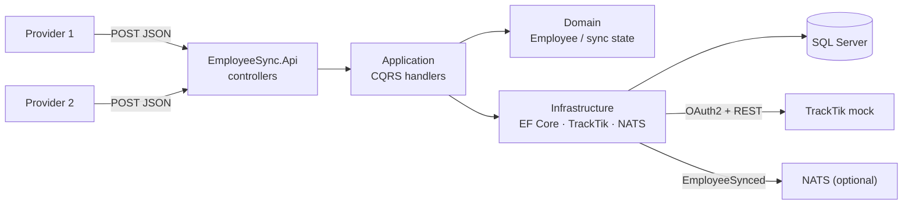

# TrackTik Employee Sync Service

A small ASP.NET Core API that receives employee records from two identity
providers, stores them in SQL Server, and synchronises them to a mock TrackTik
API using OAuth2 client credentials.

**Stack:** .NET 10 · ASP.NET Core controllers · EF Core 10 · SQL Server 2022 ·
FluentValidation · xUnit · Docker Compose

The interesting part is not the field mapping. It is the failure contract: a
record is persisted before the external call, a failed sync keeps the row as
`failed`, and a resubmission retries it without creating a duplicate.

---

## What it does

- `POST /api/v1/providers/{provider}/employees` accepts `provider1` and
  `provider2` payloads.
- Validates the provider payload, maps it to TrackTik's employee shape, and
  stores it with `syncStatus = pending`.
- Obtains an OAuth2 token, caches it until near expiry, and calls TrackTik with
  `POST` (first create) or `PUT` (already created).
- Records `synced` or `failed`, with `attempts`, `lastError` and
  `lastAttemptAt`.
- Returns `502 ProblemDetails` with the sync state when TrackTik fails; the row
  stays `failed` and is not rolled back.
- Publishes `EmployeeSynced` only after the successful sync is committed.
- Exposes `GET /api/v1/employees/{provider}/{providerEmployeeId}` for the stored
  record and its sync state.
- Exposes a small bonus report: employee counts by sync status.
- Ships an OpenAPI document, a Scalar UI, Docker Compose and tests.

---

## Quick start

### Prerequisites

- [.NET 10 SDK](https://dotnet.microsoft.com/)
- Docker Desktop with Compose v2
- Optional: `dotnet-ef` for manual migrations

### Run everything with Docker Compose

> **Shell note:** the examples use bash line continuation (`\`). On Windows
> PowerShell, use a backtick or keep the command on one line; `cp` becomes
> `Copy-Item`, and `curl` becomes `curl.exe`.

```bash
git clone https://github.com/renanmoraisdasilva/tracktik-employee-sync.git
cd tracktik-employee-sync

cp .env.example .env
# Edit .env:
#   MSSQL_SA_PASSWORD  — a local-only strong password
#   TRACKTIK_CLIENT_ID / TRACKTIK_CLIENT_SECRET — from the test package
#   (or use dotnet user-secrets for local `dotnet run`; see Configuration)

docker compose up --build
```

| Service | URL |
|---|---|
| API | http://localhost:8080 |
| OpenAPI document | http://localhost:8080/openapi/v1.json |
| Scalar API UI | http://localhost:8080/scalar/v1 |
| Health check | http://localhost:8080/health |

The API applies EF Core migrations at startup with a retry loop. SQL Server can
take 20–40 seconds on the first start; wait for its health check, then watch
`docker compose logs -f api`.

> **Never commit `.env` or `oauth-credentials.json`.** The committed
> `.env.example` contains placeholders only.

### Run the API on the host

```bash
# Start only the dependencies
docker compose up -d sqlserver nats

# Configure the TrackTik credentials outside git
cd src/EmployeeSync.Api
dotnet user-secrets init
dotnet user-secrets set "TrackTik:BaseUrl" "https://.../prod/v1"
dotnet user-secrets set "TrackTik:TokenUrl" "https://.../prod/oauth/token"
dotnet user-secrets set "TrackTik:ClientId" "YOUR_CLIENT_ID"
dotnet user-secrets set "TrackTik:ClientSecret" "YOUR_CLIENT_SECRET"

# Apply migrations and run
dotnet ef database update \
  --project ../EmployeeSync.Infrastructure \
  --startup-project .
dotnet run
```

The local API uses `http://localhost:8080` when launched with
`ASPNETCORE_URLS=http://localhost:8080`; adjust the port if your launch profile
uses another one.

---

## Configuration

Configuration is read from `appsettings.json`, user-secrets (Development) and
environment variables. Environment variables use `__` as the separator, for
example `TrackTik__ClientSecret`.

| Key | Purpose | Committed value |
|---|---|---|
| `ConnectionStrings__EmployeeSync` | SQL Server connection string | Local Docker placeholder |
| `TrackTik__BaseUrl` | TrackTik employee API base URL | Placeholder |
| `TrackTik__TokenUrl` | OAuth2 token endpoint (not under `/v1`) | Placeholder |
| `TrackTik__ClientId` | OAuth2 client ID | Placeholder |
| `TrackTik__ClientSecret` | OAuth2 client secret | **Never committed** |
| `TrackTik__Scope` | Optional scope; omit to receive all registered scopes | Empty |
| `TrackTik__TimeoutSeconds` | HTTP timeout | `15` |
| `Events__Mode` | `InMemory` or `Nats` | `InMemory` |
| `Nats__Url` | NATS connection URL | `nats://localhost:4222` |
| `Database__AutoMigrate` | Apply migrations at startup | `true` in Compose |

The Compose file sets `Events__Mode=Nats` and starts NATS. `dotnet run` defaults
to the in-memory publisher, so the API still works without a broker. Tests use
an in-memory fake.

The SQL Server host is `sqlserver` inside Compose and `localhost` from the host.
This is the most common local-run mistake; check it first.

---

## API

### POST — receive an employee

```http
POST /api/v1/providers/provider1/employees
Content-Type: application/json

{
  "emp_id": "P1_001",
  "first_name": "Alice",
  "last_name": "Johnson",
  "email_address": "alice.johnson@provider1.com",
  "phone": "+1-555-0101",
  "job_title": "Security Officer",
  "dept": "Security Operations",
  "hire_date": "2024-01-15",
  "employment_status": "active"
}
```

```http
POST /api/v1/providers/provider2/employees
Content-Type: application/json

{
  "employee_number": "P2_001",
  "personal_info": {
    "given_name": "Carol",
    "family_name": "Davis",
    "email": "carol.davis@provider2.com",
    "mobile": "+1-555-0201"
  },
  "work_info": {
    "role": "Security Guard",
    "division": "Night Shift Security",
    "start_date": "2024-02-01",
    "current_status": "employed"
  }
}
```

**Success:** `201 Created` with a `Location` header on the first insert of an
identity; `200 OK` on a resubmission/update. Both return the stored record:

```json
{
  "provider": "provider1",
  "providerEmployeeId": "P1_001",
  "employeeId": "provider1-P1_001",
  "firstName": "Alice",
  "lastName": "Johnson",
  "email": "alice.johnson@provider1.com",
  "phoneNumber": "+1-555-0101",
  "position": "Security Officer",
  "department": "Security Operations",
  "startDate": "2024-01-15",
  "status": "active",
  "syncStatus": "synced",
  "attempts": 1,
  "lastError": null,
  "lastAttemptAt": "2026-11-11T14:03:22Z",
  "createdAt": "2026-11-11T14:03:21Z",
  "updatedAt": "2026-11-11T14:03:22Z"
}
```

### GET — read an employee

```http
GET /api/v1/employees/provider1/P1_001
```

Returns the same shape. A missing employee, or an unknown provider, returns
`404` `ProblemDetails`.

### Report — bonus query

```http
GET /api/v1/reports/employees-by-sync-status
```

```json
[
  { "syncStatus": "pending", "count": 0 },
  { "syncStatus": "synced", "count": 4 },
  { "syncStatus": "failed", "count": 0 }
]
```

The query is also available as a T-SQL script:
`db/reports/employee-counts-by-sync-status.sql`.

### Errors

Every error is `application/problem+json`.

| Status | When |
|---|---|
| `400` | Validation failure; malformed JSON; unknown status/date/email. Nothing is stored or sent. |
| `404` | Unknown provider, or employee not found. |
| `502` | TrackTik token/employee call failed after the row was persisted. The body includes `syncStatus`, `attempts`, `lastError` and `lastAttemptAt`. |
| `500` | Unexpected server error, including a failed status update after TrackTik succeeded. |

A 502 example:

```json
{
  "type": "https://httpstatuses.com/502",
  "title": "TrackTik synchronization failed",
  "status": 502,
  "detail": "The employee was stored with status 'failed' but could not be synchronized.",
  "instance": "/api/v1/providers/provider1/employees",
  "syncStatus": "failed",
  "attempts": 1,
  "lastError": "TrackTik returned 500 Internal Server Error.",
  "lastAttemptAt": "2026-11-11T14:03:22Z"
}
```

---

## The sync contract

```text
Validate → map → persist pending → forward to TrackTik → commit synced/failed
```

```text
new request → pending ──success──→ synced
                    └──failure──→ failed

synced or failed ──resubmission──→ pending
```

- Only `pending`, `synced` and `failed` exist.
- The row is committed **before** the TrackTik call. A failed call updates it to
  `failed` and keeps it; it is never rolled back or deleted.
- `attempts` is a monotonic lifetime counter; it increments once per outbound
  attempt, including token failures.
- `lastError` is cleared on success.
- Resubmission updates the same row. It uses `PUT` if the employee was ever
  created in TrackTik, otherwise `POST`.
- `EmployeeSynced` is published only after the `synced` commit, once per
  successful sync.
- If the event publisher fails after the commit, the failure is logged and the
  request still succeeds. Guaranteed delivery would need an outbox (next step).

### Identity

The unique key is `(provider, providerEmployeeId)`. The TrackTik ID is derived
deterministically:

```text
provider1 + P1_001 → provider1-P1_001
provider2 + P2_001 → provider2-P2_001
```

Two providers with the same email are two different employees. They are never
merged.

### Status mapping

| TrackTik | Provider 1 | Provider 2 |
|---|---|---|
| `employeeId` | `provider1-{emp_id}` | `provider2-{employee_number}` |
| `firstName` | `first_name` | `personal_info.given_name` |
| `lastName` | `last_name` | `personal_info.family_name` |
| `email` | `email_address` | `personal_info.email` |
| `phoneNumber` | `phone` | `personal_info.mobile` |
| `position` | `job_title` | `work_info.role` |
| `department` | `dept` | `work_info.division` |
| `startDate` | `hire_date` | `work_info.start_date` |
| `status` | `employment_status` | `employed → active`, `on_leave → inactive`, `terminated → terminated` |

---

## Tests

```bash
# Default suite: unit + integration with SQLite. No Docker required.
dotnet test

# Bonus: real SQL Server through Testcontainers. Docker required.
dotnet test tests/EmployeeSync.Testcontainers
```

The default suite covers:

- mapping for both providers against the golden sample output;
- status mapping and identity derivation;
- validation failures: 400, no row, no TrackTik call;
- sync success: `synced`, attempts, cleared error, event;
- sync failure: 502, `failed` row, no event;
- resubmission: same row, POST vs PUT;
- token cache: reuse, expiry, single-flight refresh, 401 refresh;
- GET found and missing;
- unknown provider: 404;
- OpenAPI document reachable.

Testcontainers runs the integration tests against a real SQL Server container.
The category is opt-in so `dotnet test` stays fast and portable.

CI runs restore, build, unit tests, the SQLite integration tests and a secret
scan. Testcontainers tests remain local and opt-in; they are not part of the
default CI job.

Coverage snapshot and caveats: [docs/testing.md](docs/testing.md#9-coverage-philosophy).

---

## Migrations

The initial migration is committed in
`src/EmployeeSync.Infrastructure/Migrations/`.

Compose applies it automatically (`Database__AutoMigrate=true`). To apply it
manually:

```bash
dotnet ef database update \
  --project src/EmployeeSync.Infrastructure \
  --startup-project src/EmployeeSync.Api
```

To add a new migration:

```bash
dotnet ef migrations add <Name> \
  --project src/EmployeeSync.Infrastructure \
  --startup-project src/EmployeeSync.Api \
  --output-dir Migrations
```

Set `Database__AutoMigrate=false` if you want to control startup migrations
yourself.

---

## Architecture



| Layer | Owns |
|---|---|
| `EmployeeSync.Api` | Controllers, validation wiring, ProblemDetails mapping, OpenAPI, DI composition, health. |
| `EmployeeSync.Application` | Commands/queries, sync orchestration, provider adapters, validators, mappers, interfaces. |
| `EmployeeSync.Domain` | `Employee`, `EmployeeIdentity`, `SyncStatus`, `EmployeeSynced`, Result types. |
| `EmployeeSync.Infrastructure` | EF Core, migrations, repository, TrackTik client, token cache, event publishers, report query. |

```text
src/
  EmployeeSync.Api/
  EmployeeSync.Application/
  EmployeeSync.Domain/
  EmployeeSync.Infrastructure/
tests/
  EmployeeSync.UnitTests/
  EmployeeSync.IntegrationTests/
docs/
  specs/001-employee-sync/
  decisions/
  architecture.md
  testing.md
db/
  reports/employee-counts-by-sync-status.sql
docker-compose.yml
Dockerfile
```

---

## Bonus items

| Bonus | Where |
|---|---|
| **CQRS** | `SubmitEmployeeCommand`/handler and `GetEmployeeQuery`/handler in `Application`; no MediatR. |
| **NATS** | `NatsEventPublisher`; `docker compose` starts NATS; `Events__Mode=Nats`; subject `tracktik.employees.synced`; in-memory fallback for `dotnet run` and tests. |
| **T-SQL report** | `db/reports/employee-counts-by-sync-status.sql` plus `GET /api/v1/reports/employees-by-sync-status`. |
| **Testcontainers** | `tests/EmployeeSync.Testcontainers` (tagged `Category=Testcontainers`) against a real SQL Server container. |

An outbox is documented as a stretch goal, not implemented in v1.

---

## Assumptions and trade-offs

- **POST status:** `201` on the first insert, `200` on resubmission. The endpoint
  is an upsert, so "created" is not always true.
- **`attempts`:** monotonic lifetime counter, incremented per outbound attempt;
  never reset.
- **`lastError`:** cleared on success.
- **Strict validation:** payloads that pass the provider schema but lack
  `firstName`, `lastName`, `email` or `status` are rejected with 400 before
  writing, because they cannot produce a valid TrackTik employee.
- **Concurrency:** unique index on `(Provider, ProviderEmployeeId)`; a
  duplicate-key race is retried as an update. This is last-write-wins; a lost
  update is possible under extreme concurrency.
- **POST vs PUT:** decided from the persisted `ExistsInTrackTik` flag, never from
  the mock's GET (the mock is stateless and always returns a sample).
- **PUT payload:** includes `startDate` and every optional field, even though the
  mock's PUT example omits `startDate`.
- **Event publisher failure:** logged; the request still succeeds. An outbox is
  the next reliability step.
- **TrackTik success + status update failure:** the status update is retried;
  if it still fails, the API returns 500 and logs the inconsistency.
- **TrackTik rate limits:** the mock allows 100 requests per minute and 1,000 per
  hour per client. A `429` is recorded as a failed attempt and returned as `502`.
  There is no automatic retry and no `Retry-After` handling because resubmission
  is the retry mechanism.
- **No automatic retries** for TrackTik 5xx/429; resubmission is the retry
  mechanism. A 401 triggers one token refresh and one retry.
- **No auth on the provider endpoints.** The challenge does not ask for it;
  adding it would force the reviewer to obtain and send keys.
- **Integration tests:** SQLite by default; Testcontainers is opt-in.
- **NATS:** started by Compose; in-memory fallback for local runs and tests.
- **Timestamps:** UTC `DateTimeOffset`; dates are `yyyy-MM-dd`.
- **Extra JSON fields:** ignored. Null optional fields are accepted.

---

## What I would do next

- Add a transactional outbox so `EmployeeSynced` is never lost after a commit.
- Reconcile the "TrackTik succeeded but the status update failed" case with an
  idempotency key or a scheduled reconciliation job.
- Add authentication and per-tenant authorisation for provider endpoints.
- Add inbound rate limiting for provider callers and an outbound resilience
  policy (backoff and `Retry-After`) for TrackTik 429/5xx.
- Add OpenTelemetry tracing and metrics.
- Add integration/Testcontainers tests to CI with a SQL Server service container.
- Add a `SyncAttempts` table for auditability.
- Add contract tests generated from the OpenAPI document.
- Support more providers through the same adapter interface.

---

## Security

- **No secrets in git.** `oauth-credentials.json`, `.env`, user-secrets and real
  passwords are excluded. `.env.example` has placeholders only.
- **Parameterised data access.** EF Core is used throughout; there is no
  string-built SQL.
- **Tokens stay in memory.** They are not stored in the database or written to
  logs.
- **PII-aware logging.** Logs carry provider/employee identifiers and outcomes,
  not full payloads.
- **Input validation.** Provider payloads are validated before persistence and
  before the external call.

---

## Documentation

- [Documentation index](docs/README.md) — the map of the docs.
- [Specification](docs/specs/001-employee-sync/spec.md) — what the service must
  do, including acceptance criteria.
- [Plan](docs/specs/001-employee-sync/plan.md) — phases and exit criteria.
- [Tasks](docs/specs/001-employee-sync/tasks.md) — implementation checklist.
- [Research](docs/specs/001-employee-sync/research.md) — challenge and mock API
  facts.
- [Data model](docs/specs/001-employee-sync/data-model.md) — schema and indexes.
- [OpenAPI contract](docs/specs/001-employee-sync/contracts/openapi.yaml) — the
  spec-first API shape.
- [Architecture](docs/architecture.md) — components and runtime flow.
- [Testing](docs/testing.md) — test strategy and commands.
- [ADRs](docs/decisions/) — why the consequential choices were made.

---

## License

This repository is a take-home submission. No license is granted.
