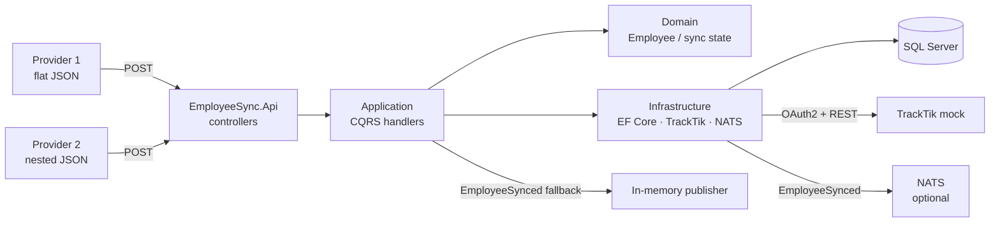
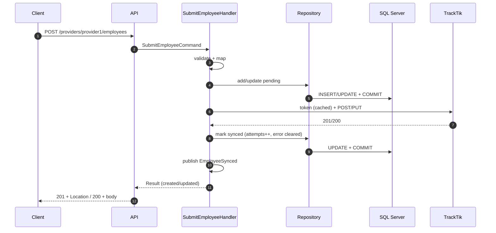
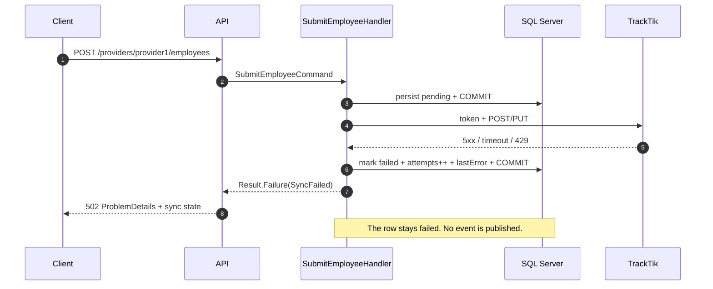
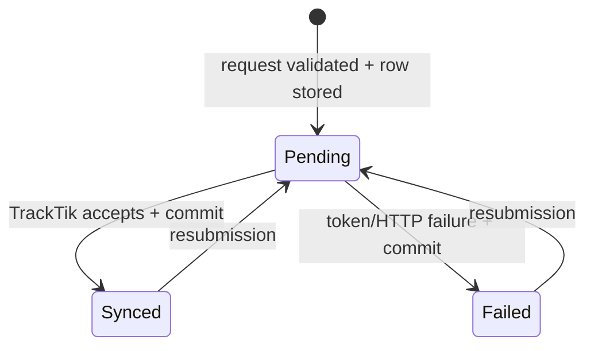
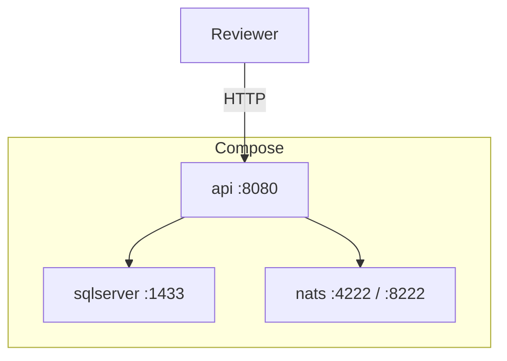

# Architecture

- **Status:** Accepted
- **Date:** 2026-11-11
- **Spec:** [`specs/001-employee-sync/spec.md`](specs/001-employee-sync/spec.md)
- **Decisions:** [`decisions/`](decisions/)

---

## 1. Context



The API is the only entry point. Providers never talk to TrackTik; the browser
or reviewer never sees the TrackTik credentials.

## 2. Layers

| Layer | Project | Owns | Must not own |
|---|---|---|---|
| API | `EmployeeSync.Api` | Controllers, validation wiring, `ProblemDetails` mapping, OpenAPI, DI, health | Business rules, SQL, TrackTik HTTP details |
| Application | `EmployeeSync.Application` | Commands/queries, sync orchestration, provider adapters, validators, mappers, interfaces | EF Core, ASP.NET types |
| Domain | `EmployeeSync.Domain` | `Employee`, `EmployeeIdentity`, `SyncStatus`, `EmployeeSynced`, `Result` | Database attributes, HTTP, JSON |
| Infrastructure | `EmployeeSync.Infrastructure` | EF Core, migrations, repository, TrackTik client, token cache, event publishers, report query | Controllers, business decisions |

Dependency rule:

```text
Api → Application → Domain
Api → Infrastructure → Application → Domain
Infrastructure → Application → Domain
```

Domain has no dependency on the other projects. Application has no dependency on
EF Core or ASP.NET Core.

## 3. Request flow — success



## 4. Request flow — TrackTik failure



## 5. Sync state machine



Only `pending`, `synced` and `failed` exist.

## 6. TrackTik client and token cache

- `TrackTikClient` is a typed `HttpClient` registered through
  `IHttpClientFactory`.
- `BaseAddress` is `TrackTik:BaseUrl`; `Timeout` is
  `TrackTik:TimeoutSeconds`.
- `ITrackTikTokenProvider` is a singleton:
  - caches the token and expiry;
  - refreshes 60 seconds before expiry;
  - uses `SemaphoreSlim` for single-flight refresh;
  - invalidates on `401` and allows one retry;
  - wraps a token-endpoint timeout as `TrackTikException`, so it follows the
    same failed-sync contract as an employee-call failure while caller
    cancellation still propagates.
- The token is never logged, stored in the database or sent to another host.

## 7. Event publishing

- `IEventPublisher` is the seam.
- `InMemoryEventPublisher` is the default for `dotnet run` and tests.
- `NatsEventPublisher` is selected by `Events:Mode=Nats`; Compose sets it.
- Subject: `tracktik.employees.synced`.
- Payload: `eventId`, `eventType`, `occurredAt`, `provider`,
  `providerEmployeeId`, `employeeId`, `attempts`.
- Publishing happens after the `synced` commit, so the event describes durable
  state.
- A publisher failure is logged and the request still succeeds, because the sync
  itself completed; an error would invite a retry of a committed sync.
- The transactional outbox is the next reliability step, not v1.

## 8. Data

See [`specs/001-employee-sync/data-model.md`](specs/001-employee-sync/data-model.md).

- `Employees` table with a unique index on
  `(Provider, ProviderEmployeeId)`.
- `SyncStatus` and `Status` check constraints.
- `ExistsInTrackTik` drives POST vs PUT.
- Committed migrations.
- Optional report query.

## 9. Compose topology



- SQL Server has a named volume and a health check.
- The API waits for SQL Server and applies migrations with retry.
- NATS is included for the bonus; the API still runs without it when
  `Events:Mode=InMemory`.

## 10. Security

- No secrets in git; user-secrets or `.env` for local credentials.
- TrackTik credentials are read from configuration.
- EF Core parameterisation; no string-built SQL.
- Tokens stay in memory; no token/PII logging.
- The API has no authentication in v1; the challenge does not require it and it
  would add reviewer friction.

## 11. Known limitations

- If TrackTik succeeds but the status update fails, the row can be stale. The
  service retries the update, then returns 500 and logs it.
- If the event publisher fails after the commit, the event is lost. An outbox is
  the next step.
- A POST that succeeds in TrackTik but fails its DB update can leave
  `ExistsInTrackTik = false`; a retry could POST again in a real system. The
  mock is stateless, so this is not observable there.
- Last-write-wins concurrency; a lost update is possible under extreme
  concurrency.
- No inbound API authentication or rate limiting, no automatic retries and no
  OpenTelemetry in v1. TrackTik's own rate limit (`429`) is treated as one failed
  attempt; see [ADR-008](decisions/ADR-008-upstream-failures.md).

## 12. ADRs

- [ADR-001](decisions/ADR-001-spec-workflow.md) — docs workflow.
- [ADR-002](decisions/ADR-002-architecture.md) — controllers, layers, CQRS.
- [ADR-003](decisions/ADR-003-persist-before-forward.md) — sync state machine.
- [ADR-004](decisions/ADR-004-identity-and-upsert.md) — identity and POST/PUT.
- [ADR-005](decisions/ADR-005-validation-mapping-errors.md) — validation/mapping.
- [ADR-006](decisions/ADR-006-testing-and-ci.md) — testing and CI.
- [ADR-007](decisions/ADR-007-bonus-scope.md) — bonus scope.
- [ADR-008](decisions/ADR-008-upstream-failures.md) — upstream failure and
  rate-limit policy.
